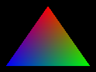
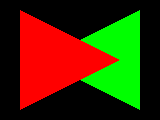
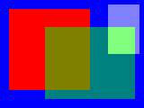
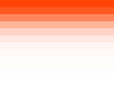
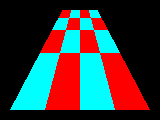
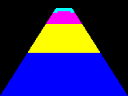
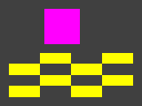
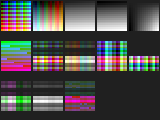

# rustyglide

rustyglide implements the 3dfx Glide API in Rust on [wgpu](https://wgpu.rs):
Vulkan, Metal, DirectX 12 or OpenGL, chosen at runtime. It aims to match
[OpenGLide-ng](https://github.com/eugenenuke/openglide-ng) feature for
feature and to be reusable by any game that used a Voodoo card.

- **A Rust library.** A program links `rustyglide` and calls Glide in process,
  drawing into its own window (SDL2, winit or anything with a raw window
  handle). [Maiko](https://github.com/michidk/maiko), which runs Redguard
  natively, is the first user.
- **A drop-in `glide2x`.** The `glide2x` crate builds `glide2x.dll` /
  `libglide2x.so` with all 127 Glide 2.4x exports, including the decorated
  32-bit Windows names.

## Scenes

Rendered headless by the test suite on lavapipe; each is a golden image CI
compares against (`crates/rustyglide-scenes`).

<table>
  <tr><td align="center"><br>Gouraud shading</td><td align="center"><br>Z-buffer</td><td align="center"><br>Alpha blending</td><td align="center"><br>Table fog</td></tr>
  <tr><td align="center"><br>Perspective-correct texture</td><td align="center"><br>Mipmaps</td><td align="center"><br>Chroma key</td><td align="center"><br>Every texture format</td></tr>
</table>

## Status

Glide 2.4x is implemented: combiners, blending, chroma key, alpha test, Z and
W buffers, table and iterated fog, every texture format with palettes and NCC
tables, mipmaps, multibase, the LFB, the `gu*` texture manager and `.3df`
loader, state save and restore, and clipped drawing.

Not yet: Glide 3 (`glide3x`) and 2.1x (`glide.dll`) front ends, a window of its
own for the drop-in on Linux and macOS (it renders off screen there), edge
antialiasing, dithering to 16 bits, and the 3dfx splash screen. Only Redguard
is targeted for testing so far. See [docs/design.md](docs/design.md).

## Use

```rust
use rustyglide::{Glide, Settings, Target, types::*};

let mut glide = Glide::new(Settings::from_env());
// SAFETY: the window outlives `glide`.
let target = unsafe { Target::window(&window, (1280, 960))? };
glide.sst_win_open(target, Resolution::R640x480, ColorFormat::Argb, Origin::UpperLeft)?;
glide.gu_color_combine_function(ColorCombineFnc::Itrgb);
glide.draw_triangle(&a, &b, &c);
glide.buffer_swap(1);
```

State and drawing calls are methods of `rustyglide_core::Context`, reached
through `Glide`. `set_present_hook` runs after each presented frame with the
wgpu device and the window's frame, for overlays.

Settings come from the environment:

| Variable | Effect |
|---|---|
| `RUSTYGLIDE_SCALE` | Render at this multiple of the game's resolution (1 to 8). |
| `RUSTYGLIDE_TMUS` | Texture units reported to the game (1 or 2, default 1). |
| `RUSTYGLIDE_TEXTURE_MEMORY_MB` | Texture memory per unit (default 4). |
| `RUSTYGLIDE_FILTER` | `point` or `bilinear` overrides the game's texture filter. |
| `RUSTYGLIDE_NO_MIPMAPS` | `1` ignores mipmapping. |
| `WGPU_BACKEND` | `vulkan`, `metal`, `dx12` or `gl`. |

## Layout

| Crate | Responsibility |
|---|---|
| `rustyglide-core` | Glide state, texture memory and formats, fog, LFB pixels. No GPU types. |
| `rustyglide-wgpu` | Runs the core's commands with wgpu; the Voodoo pixel pipeline in WGSL. |
| `rustyglide` | The public API: core plus renderer plus a window. |
| `glide2x` | The Glide 2.4x C ABI as a drop-in library. |
| `rustyglide-scenes` | Feature scenes, golden images and the combiner check. |

## Development

`just gates` runs what CI runs: formatting, clippy, `cargo deny`, the core
boundary check, unit tests and the GPU tests. GPU tests run on lavapipe
(software Vulkan); without a local Vulkan driver `bash dev/scripts/gpu-test.sh`
runs them in Docker. They skip on machines without a GPU unless
`RUSTYGLIDE_REQUIRE_GPU=1`.

Scenes render headless and compare with `crates/rustyglide-scenes/golden/`.
After an intended change, `just bless` rewrites the images and `just sheet`
shows them side by side for review.

## Releases

Run **Bump Version & Tag** (`bump-version.yml`) on `main`: git-cliff picks
the next version from the Conventional Commits, the workflow commits it and
pushes the tag. The tag starts `release.yml`, which verifies the tag, builds
`glide2x` for Linux, Windows (32 and 64-bit) and macOS, publishes the GitHub
release with `SHA256SUMS`, then publishes `rustyglide-core`,
`rustyglide-wgpu` and `rustyglide` to crates.io with trusted publishing.

One-time setup:

- Repository secrets `RELEASER_APP_ID` and `RELEASER_APP_PRIVATE_KEY` (the
  release App, as in Cyrus) and an environment named `crates-io`.
- Trusted publishing works only for crates that already exist: publish 0.1.0
  of the three crates once by hand, then add a trusted publisher to each on
  crates.io (repository `michidk/rustyglide`, workflow `release.yml`,
  environment `crates-io`).

## Redguard projects

rustyglide grew out of work on *The Elder Scrolls Adventures: Redguard* (1998):

- [Maiko](https://github.com/michidk/maiko): runs the original game natively
  on Windows, Linux and macOS, without DOSBox; rustyglide is its renderer.
- [Cyrus](https://github.com/michidk/cyrus): Redguard rebuilt in Rust and Bevy.
- [Redguard Preservation](https://github.com/michidk/redguard-preservation):
  file format specifications, engine documentation and a Rust CLI for the
  game's assets.

## Licence

MIT OR Apache-2.0. See [THIRD_PARTY.md](THIRD_PARTY.md) for the sources that
informed it.
